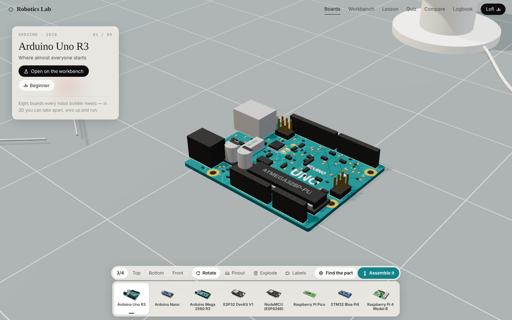
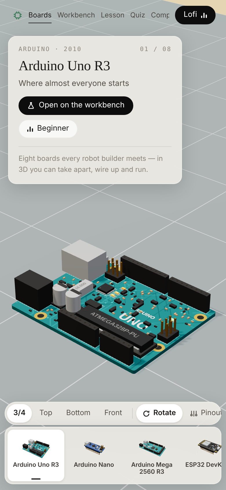

# Robotics Lab — apprendre l'électronique en assemblant en 3D

[](https://github.com/Skysaks/ROBOTICS-LAB/actions/workflows/ci.yml)

> **EN** — An interactive 3D lab for makers: take apart eight popular boards (Arduino, ESP32, Raspberry Pi…), wire them with fifteen modules on a virtual ESD mat, run twelve guided missions with a circuit checker that catches shorts and 5 V into 3.3 V pins, then take the lesson and the quiz. Interface in English.

**Démonstration** : [skysaks.github.io/ROBOTICS-LAB](https://skysaks.github.io/ROBOTICS-LAB/) · fichier autonome : [`dist/robotics-lab.html`](dist/robotics-lab.html) (à télécharger et ouvrir, hors ligne, sans installation ; navigateur avec WebGL).



> © 2026 Florian Iglesias — Tous droits réservés. Dépôt public à titre de portfolio uniquement : aucune licence n'est concédée. Voir [LICENSE](LICENSE). three.js reste sous licence MIT.

## Le principe

Les débutants en électronique apprennent sur des schémas plats puis grillent leur première carte en branchant du 5 V sur une broche 3,3 V. Robotics Lab fait l'inverse : on **manipule** les cartes en 3D, on câble sur un tapis antistatique virtuel, et un vérificateur explique chaque erreur **avant** qu'elle ne coûte une carte.

## Fonctionnalités

- **Galerie de huit cartes** — Arduino Uno R3, Nano, Mega 2560, ESP32 DevKit, NodeMCU (ESP8266), Raspberry Pi Pico, STM32 Blue Pill, Raspberry Pi 4 : rotation, vues de dessus, dessous et face, brochage, éclaté, étiquettes, « trouver le composant », mode assemblage pas à pas.
- **Atelier** — quinze modules (LED, LED RVB, buzzer, écran OLED, bouton, potentiomètre, capteur à ultrasons, DHT11, photorésistance, PIR, servo, moteur…), fils de huit couleurs aimantés aux broches, soudure, annuler / rétablir, nomenclature avec coût estimé, projets enregistrés dans le navigateur.
- **Vérificateur de circuit** — courts-circuits, 5 V sur une broche 3,3 V, carte 3,3 V qui pilote une carte 5 V sans convertisseur de niveau : chaque problème est expliqué.
- **Douze missions guidées**, du « Hello, LED » au projet multi-cartes (récepteur Nano, ESP32 en 3,3 V, Mega pour la puissance), avec niveau et durée.
- **Leçon** (six chapitres : tension, courant, masse…), **quiz** de huit questions, **comparateur** de cartes, **journal** de progression.
- **Tout est généré par le code** : modèles 3D procéduraux, textures dessinées sur canvas, sons synthétisés ; aucune image, aucun modèle, aucun fichier audio.

| Ordinateur | Téléphone |
|---|---|
|  |  |

## Construire et tester

Node 22 (voir `.nvmrc`). Aucune dépendance d'exécution hors three.js, embarqué ; Playwright sert uniquement aux tests.

```bash
npm ci
npm run dev        # http://localhost:5173, reconstruit à chaque modification de src/
npm run build      # src/ → dist/robotics-lab.html (fichier unique, three.js inclus)
npm run verify     # aucune ressource externe, budget de taille, aucune donnée personnelle
npm test           # tests d'intégrité (node:test) + parcours bureau et mobile (Playwright, rendu WebGL logiciel)
npm run captures   # régénère docs/captures/
```

## Structure du dépôt

```
src/
  index.html                  gabarit : navigation, sections, ordre des scripts
  styles/                     01-base … 10-complements
  vendor/three.min.js         three.js r160 (MIT), inchangé
  js/
    01-donnees.js             cartes, modules, prix indicatifs, missions, leçon, quiz
    02-outils.js              rendu, environnement, caméra orbitale, sons, stockage
    03-modeles-3d.js          modèles procéduraux : composants, cartes, modules
    04-galerie-assemblage.js  galerie et mode assemblage
    05-atelier.js             atelier : pièces, câblage, soudure, vérification, missions, nomenclature
    06-navigation-lecon-quiz.js, 07-demarrage.js
dist/robotics-lab.html        fichier construit, autonome (≈ 830 Ko, dont ≈ 655 Ko de three.js)
scripts/  tests/  docs/
```

## Choix techniques

- **three.js plutôt qu'un moteur maison** : le rendu physique, les ombres et l'environnement valent les ≈ 655 Ko embarqués ; le reste (modèles, interactions, vérification) est écrit pour le projet.
- **Modèles procéduraux** : chaque carte est construite à partir d'une description (dimensions, broches, composants, couleur) ; ajouter une carte, c'est ajouter des données, pas un fichier 3D.
- **Vérification par règles électriques** sur le graphe des connexions (rails d'alimentation, niveaux logiques), pas par comparaison avec un montage attendu : les montages libres sont vérifiés aussi.

## Limites connues

1. **Simulation pédagogique**, pas un simulateur électrique : pas de calcul de courant ni de résistance de limitation ; les règles couvrent les erreurs de débutant les plus coûteuses.
2. **WebGL requis** ; sur un GPU logiciel (tests automatiques), l'ouverture prend plusieurs secondes.
3. **Prix indicatifs** des cartes et modules, non mis à jour.
4. **Tests automatiques sur Chromium** (bureau et mobile émulé) ; Safari et Firefox ne sont pas couverts par la CI.

## Sécurité et confidentialité

Aucune donnée personnelle : les projets et la progression restent dans le navigateur (`localStorage`). Signalement des failles : [SECURITY.md](SECURITY.md).

## Licence

© 2026 Florian Iglesias — Tous droits réservés ([LICENSE](LICENSE)). three.js : licence MIT, © 2010-2023 three.js authors ([docs/licences/three.js-MIT.txt](docs/licences/three.js-MIT.txt)). Les noms de cartes sont ceux de leurs fabricants, cités à titre descriptif. Contributions : [CONTRIBUTING.md](CONTRIBUTING.md).
