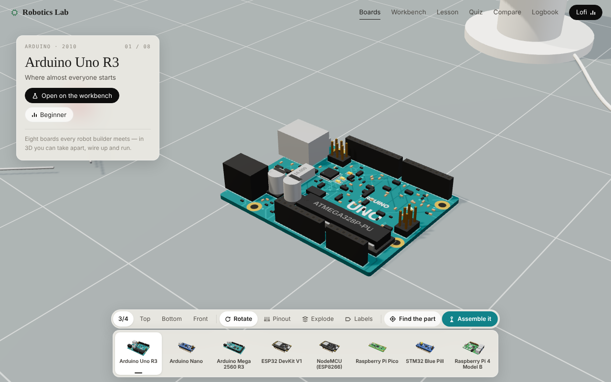

# ROBOTICS-LAB

Atelier d'électronique en 3D : huit cartes que tout constructeur de robots croise, à démonter, câbler et faire tourner.

## Fonctionnalités

- Cartes en 3D : Arduino Uno R3, Nano, Mega 2560, ESP32 DevKit, NodeMCU, Raspberry Pi Pico, STM32 Blue Pill, Raspberry Pi 4
- Vue éclatée, brochage, repérage et assemblage des composants comme un kit
- Établi de câblage : capteurs, moteurs, écrans, missions guidées ou montage libre, vérification des connexions avant mise sous tension
- Leçons, quiz, comparateur de cartes et carnet de bord

## Lancer

Ouvrir `index.html` dans un navigateur avec WebGL.

## Technique

Application monofichier en JavaScript ; rendu 3D avec three.js (bibliothèque intégrée au fichier). Interface en anglais.

## Statut

Fonctionnel.

## Droits

© 2026 Florian Iglesias – Tous droits réservés. Code publié à titre de présentation : aucune licence d'utilisation, de copie ou de redistribution n'est accordée.
